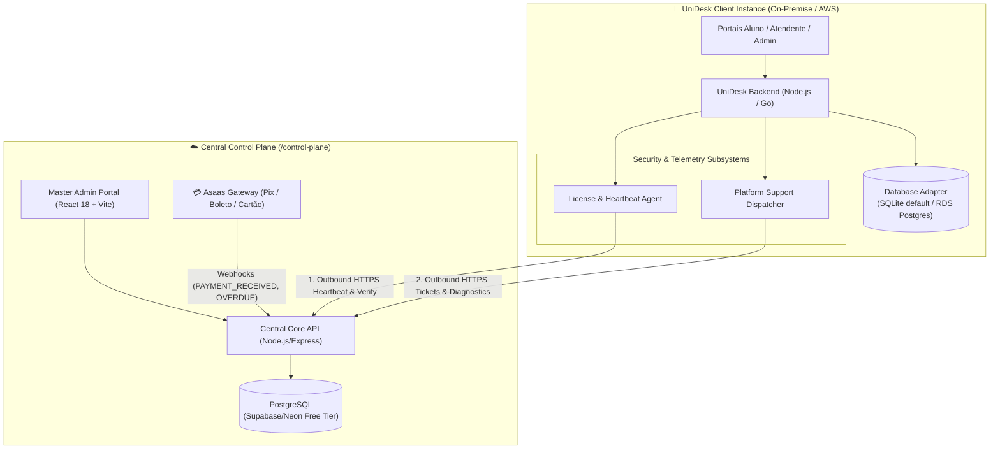
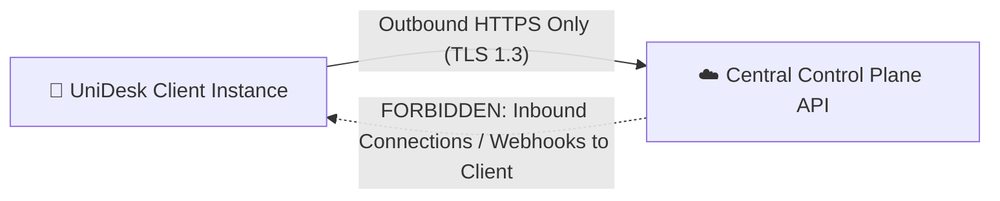

# Architecture Spine — UniDesk Multi-Tenant & Central Control Plane

## Design Paradigm

Distributed **Hub-and-Spoke** with **Asymmetric Cryptographic Offline-First Licensing**:
- **Spokes (Client Instances)**: Autonomous, self-contained runtimes hosted either on-premise (bare-metal, local VMs) or in private customer clouds (AWS, GCP, OCI). State is isolated per tenant.
- **Hub (Central Control Plane)**: Master cloud orchestrator hosted with zero initial cost overhead. Manages commercial lifecycles (Asaas subscriptions), cryptographic license issuance, and vendor-level N2/N3 technical support.



---

## Invariants & Rules

### Dependency Direction Rule



---

### AD-1 — Asymmetric Cryptographic License Tokens (Ed25519) [ADOPTED]

- **Binds:** `licensing-and-billing`, `client-instance-runtime`
- **Prevents:** Client-side license spoofing, offline clock manipulation, and local database tampering.
- **Rule:** The Central Control Plane holds an Ed25519 private key in environment secrets. When issuing or renewing a license, it produces an encrypted/signed JWT payload containing `tenant_id`, `license_key`, `instance_uuid`, `valid_until`, `grace_until`, and `status`. The UniDesk Client Instance packages only the corresponding Ed25519 **public key** and validates token signatures locally without needing synchronous cloud approval on every request.

---

### AD-2 — Strictly Outbound Communication Topology [ADOPTED]

- **Binds:** `network-and-firewall`, `client-instance-runtime`
- **Prevents:** Deployment failures caused by client-side NATs, corporate firewalls, and requirement for static public IPs.
- **Rule:** No inbound traffic from the Central Control Plane to any client instance shall ever be required. All communications (license heartbeats, subscription status synchronization, support ticket dispatches, telemetry) MUST originate from the client instance as outbound HTTPS requests to the Central Control Plane API with an `X-License-Key` and `X-Instance-UUID` authorization envelope.

---

### AD-3 — 15-Day Tiered Grace Period Enforcement Policy [ADOPTED]

- **Binds:** `licensing-and-billing`, `client-instance-runtime`
- **Prevents:** Abrupt operational disruption of student services while guaranteeing revenue enforcement.
- **Rule:** 
  1. **Days 1–15 (Payment Due / Overdue):** The system transitions to `STATUS_GRACE_PERIOD`. All academic and student service workflows remain fully functional. An unavoidable, persistent warning banner is injected exclusively into the Local Administrator Portal displaying payment instructions and invoice links.
  2. **Day 16 onwards (Overdue past grace):** The system transitions to `STATUS_LOCKED`. All non-admin routes return HTTP 402 (Payment Required). The web interface renders a blocking modal showing invoice details and an Asaas Pix QR Code. No tickets can be created or updated until renewal.

---

### AD-4 — Zero-Cost Cloud Database Strategy with Multi-Tier Dialects [ADOPTED]

- **Binds:** `database-strategy`, `central-control-plane`, `client-instance-runtime`
- **Prevents:** Unnecessary monthly infrastructure overhead for the SaaS provider and allows deployment freedom for clients.
- **Rule:**
  1. **Central Control Plane:** Must run exclusively against a managed PostgreSQL free tier (Supabase or Neon) with zero idle cost.
  2. **UniDesk Client Instance:** Must use the Database Adapter pattern. Default configuration operates on embedded zero-cost **SQLite** (`unidesk.db`). If the client elects to deploy on cloud infrastructure (AWS/GCP/Azure), the backend must switch seamlessly to a remote relational engine (PostgreSQL/MySQL) via the `DATABASE_URL` connection string without altering core business logic.

---

### AD-5 — Monorepo Project Structure with Independent Deployable Units [ADOPTED]

- **Binds:** `repository-organization`, `build-system`
- **Prevents:** Repository fragmentation, drift between license validation libraries, and divergent schema definitions.
- **Rule:** The Central Control Plane resides in the same Git repository as the UniDesk application under the top-level directory `/control-plane`. Shared cryptographic contracts and data transfer object (DTO) interfaces are maintained in a shared namespace.

---

### AD-6 — In-App Vendor Support & Diagnostic Telemetry Gateway [ADOPTED]

- **Binds:** `platform-support-gateway`, `central-control-plane`
- **Prevents:** Lost customer support requests, manual email overhead, and missing technical diagnostics for on-premise bugs.
- **Rule:** The Local Admin Portal must feature a "Suporte da Plataforma" interface. When an admin logs a issue regarding the UniDesk software, the request is dispatched via REST to `/api/v1/support/tickets` on the Central Control Plane, accompanied by an anonymized diagnostic payload (Node.js/Go runtime version, database engine type, migration version, recent error log excerpts).

---

## Consistency Conventions

| Concern | Convention |
| :--- | :--- |
| **API Envelope** | `{ "success": boolean, "data": { ... }, "error": { "code": string, "message": string } }` |
| **License Headers** | `X-Tenant-License-Key`, `X-Instance-UUID`, `X-Signature-Version` |
| **Time Format** | UTC ISO-8601 (`YYYY-MM-DDTHH:mm:ss.sssZ`) across all databases and payloads |
| **Central Routes** | `/api/v1/license/activate`, `/api/v1/license/heartbeat`, `/api/v1/support/tickets`, `/api/v1/webhooks/asaas` |
| **Status Enum** | `ACTIVE`, `GRACE_PERIOD`, `SUSPENDED`, `REVOKED` |

---

## Stack Matrix

| Component | Technology | Version | Purpose |
| :--- | :--- | :--- | :--- |
| **Local Backend** | Node.js / Go | Node 20+ / Go 1.22+ | Existing hybrid runtime |
| **Local Database** | SQLite (`node:sqlite` / `DatabaseSync`) | SQLite 3.x | Default zero-cost local embedded storage |
| **Cloud Client DB** | PostgreSQL / MySQL | Postgres 15+ / MySQL 8+ | Enterprise cloud customer hosting |
| **Central Backend** | Node.js (Express / Fastify) | Node 20 LTS | SaaS Management API & Webhook Gateway |
| **Central Database** | PostgreSQL (Supabase / Neon) | Postgres 16 | Free-tier central database |
| **Central Frontend** | React 18 + Vite + TailwindCSS | React 18.x | Master billing and support dashboard |
| **Payment Gateway** | Asaas API v3 | v3 REST API | Subscriptions, Pix, Boleto, Credit Cards |
| **Cryptography** | `node:crypto` (Ed25519) | Native WebCrypto / Edwards-curve | Asymmetric license signing |

---

## Structural Seed

```text
UniDesk/
├── src/                          # UniDesk Client Backend (Node.js)
│   ├── config/                   # Configuração e variáveis de ambiente
│   ├── licensing/                # Módulo cliente: verificação Ed25519, heartbeat e cache
│   │   ├── licenseVerifier.js    # Verificador matemático local do JWT assinado
│   │   ├── heartbeatClient.js    # Worker diário de sincronização outbound
│   │   └── licenseState.js       # Gerenciador de estado (ACTIVE, GRACE_PERIOD, LOCKED)
│   ├── support/                  # Dispatcher de tickets para a Central
│   │   └── supportClient.js      # Envio de chamados e telemetria de logs
│   ├── database/                 # Database Adapter (SQLite / PostgreSQL)
│   └── routes/
├── frontend/                     # UniDesk Client Frontend (React 18 + Vite)
│   └── src/
│       ├── components/
│       │   ├── GracePeriodBanner.jsx  # Banner de aviso para administradores (dias 1-15)
│       │   └── LicenseLockModal.jsx   # Bloqueio total (dia 16+) com Pix do Asaas
│       └── pages/
│           └── AdminSupport.jsx       # Interface de abertura de chamado com o fornecedor
│
├── control-plane/                # Sistema Central (SaaS HQ / Central Admin)
│   ├── backend/
│   │   ├── src/
│   │   │   ├── controllers/
│   │   │   │   ├── licenseController.js   # Emissão e heartbeat de licenças
│   │   │   │   ├── webhookController.js   # Webhooks do Asaas (pagamentos)
│   │   │   │   └── supportController.js   # Gestão de chamados das empresas
│   │   │   ├── services/
│   │   │   │   ├── asaasService.js        # Integração com API v3 do Asaas
│   │   │   │   ├── cryptoService.js       # Assinatura de tokens com chave privada Ed25519
│   │   │   │   └── ticketService.js       # Regras de suporte N2/N3
│   │   │   ├── db/                        # Conexão PostgreSQL (Supabase / Neon)
│   │   │   └── server.js                  # Ponto de entrada da API Central
│   │   └── package.json
│   └── frontend/                          # Painel Web Master (Você / Administrador da SaaS)
│       ├── src/
│       │   ├── pages/
│       │   │   ├── TenantsDashboard.jsx   # Lista de empresas clientes e licenças
│       │   │   ├── FinancialDashboard.jsx # Faturas e assinaturas do Asaas
│       │   │   └── TicketsDashboard.jsx   # Chamados técnicos recebidos das empresas
│       └── package.json
│
└── _bmad-output/                 # Artefatos de planejamento e governança BMad
```

---

## Deferred

1. **Self-Service Customer Invoicing Portal**: Permitir que o próprio financeiro da empresa acesse uma URL central pública para reimprimir boletos (no momento, links e QR Codes Pix são entregues diretamente no modal de cobrança in-app e por e-mail via Asaas).
2. **Automated Remote Telemetry Patching**: Atualização de código Over-The-Air (OTA) das instâncias locais (as atualizações continuarão sendo aplicadas via Git pull / Docker update / executável).
